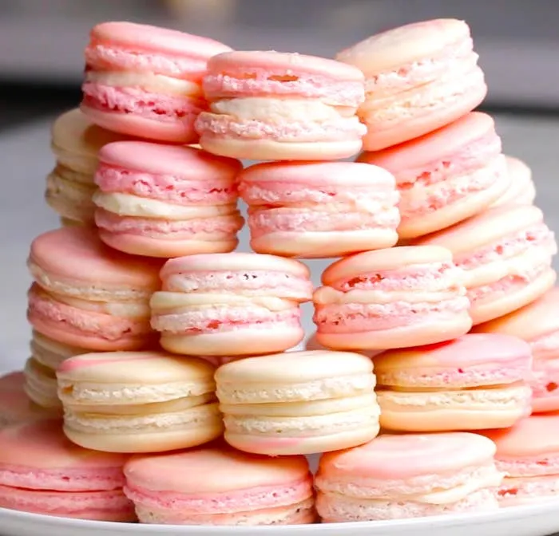
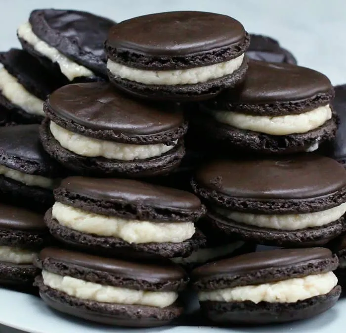
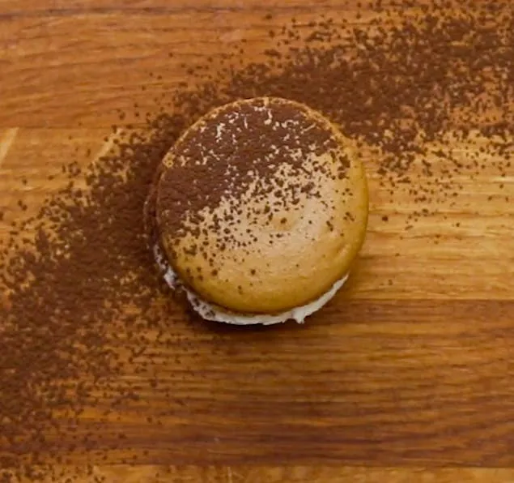

---
# Generated from a Google Doc by `npm run sync` — edit the Google Doc, not this file;
# local changes are overwritten on the next sync.
title: טיפים למקרונים ומתכון
slug: tifim-lmkronim-vmtchon
image: ./photo-1.webp
ingredients:
  - כ-50 מקרונים (כ-100 עוגיות נפרדות)
  - 200 גרם (2 כוסות) אבקת שקדים
  - 200 גרם (2/3 1 כוסות) אבקת סוכר
  - 220 גרם (1 כוס ועוד 2 כפות) סוכר
  - 50 גרם (1/4 כוס פחות 2 כפיות) מים
  - 150 גרם חלבון (כ-4 חלבונים מביצים בגודל L)
  - צבע מאכל לפי הטעם
  - 50 גרם (1/4 כוס) סוכר
  - 200 גרם (3/4 כוס ועוד 1 כף) שמנת מתוקה
  - 30 גרם חמאה
  - 300 גרם שוקולד חלב
  - 60 גרם (1/4 כוס) מים
  - 125 גרם (1/2 כוס ועוד 2 כפות) סוכר
  - 80 גרם חלמון (כ-4 חלמונים מביצים בגודל L)
  - גרגירים מ-1 מקל וניל
  - 200 גרם חמאה רכה, חתוכה לקוביות קטנות
  - 100 גרם (1/3 כוס ועוד כף) שמנת מתוקה
  - 100 גרם (1/3 כוס ועוד כף) מיץ תפוזים או מחית קלמנטינה/תפוזים
  - 10 גרם (2 כפיות) מיץ לימון
  - 30 גרם חמאה
  - קליפה מגוררת מקלמנטינה או פרי הדר אחר
  - 300 גרם שוקולד חלב
  - 1⅓ cups almond meal, super-fine
  - 1¾ cups powdered sugar
  - 4 egg whites, cold
  - ½ cup sugar
  - 2 teaspoons cocoa powder
  - 2 teaspoons raspberry jam, strained
  - ¼ teaspoon red liquid food coloring
  - 1 cup white chocolate chips, melted
  - 4 ounces cream cheese
  - 3 eggs whites, room temperature
  - ¼ cup sugar
  - 1¾ cup powdered sugar
  - 1 cup superfine almond flour
  - 3 drops red food coloring
  - "Filling:"
  - 1 8-ounce package of cream cheese
  - 1 cup powdered sugar
  - 2 tablespoons milk
  - Strawberry jam
  - 3 eggs whites, room temperature
  - ¼ cup sugar
  - 1¼ cups powdered sugar
  - ¾ cup superfine almond flour
  - ¼ cup crushed chocolate cookies
  - 2 tablespoons dark cocoa powder
  - ½ teaspoons black food coloring
  - 2 cups of powdered sugar
  - 1 cup of softened butter
  - 1 teaspoons of vanilla
  - 2 tablespoons of milk
  - ½ cup cookies and cream filling
  - "For the cookie:"
  - 3 large egg whites (100g), room temperature
  - ¼ cup granulated sugar (50g)
  - 1 ¾ cup powdered sugar (200g)
  - 1 cup superfine almond flour (110g) (if unable to find "superfine" it is recommended that you pulse the almond flour in a food processor first)
  - 2 tablespoons instant espresso powder
  - "For the buttercream filling:"
  - ½ cup butter, room temperature
  - 2 cups powdered sugar, sifted
  - 2 teaspoons vanilla extract
  - Cocoa powder for dusting (optional)
driveId: 1kfEB3EHiPCD0kHpdD70gyG1-gnDKIcqwDH1Zx7J_48w
driveModified: 2020-10-25T18:09:58.433Z
---

### כך תכינו מקרונים מושלמים

- הקפידו לשקול את כל המרכיבים מראש (לתוצאה מושלמת, חשוב להקפיד במדידה) ולהכין את הציוד הנדרש: תבנית אפייה מרופדת בנייר אפייה, שק זילוף עם צנטר חלק ותנור שחומם לטמפרטורה הנכונה.
- ככל שאבקת השקדים תהיה דקה ואחידה יותר, כך יהיו פני העוגיות המוכנות חלקים יותר. לכן הקפידו לרכוש אבקת שקדים איכותית, בהירה ואחידה ככל האפשר. לקבלת תוצאה טובה יותר, אפשר לטחון את אבקת השקדים עם אבקת הסוכר במעבד מזון ולאחר מכן לנפות את התערובת פעמיים. אם נותרות בנפה שאריות של אבקת שקדים שלא נטחנה היטב, שקלו אותן ונפו כמות נוספת של האבקה להשלמת הכמות שבמתכון.
- אפשר להשתמש בחלבונים מיושנים (חלבונים שהופרדו מהחלמונים ושהו במקרר במשך יום לפחות), אבל ממש לא חובה. בהחלט אפשר להשתמש גם בחלבונים טריים, קרים או בטמפרטורת החדר.
- הדבר החשוב ביותר להצלחת המרנג הוא הקפדה על כך שלחלבונים לא תחדור ולו הטיפה הקטנה ביותר של חלמון, שתפגע בהקצפה. חיוני גם להקפיד על שימוש בקערת מיקסר ובמקצפים נקיים לחלוטין משומן.
- בהכנת מקרונים משתמשים במרנג איטלקי – מרנג שמוסיפים לו סירופ סוכר רותח תוך כדי הקצפה. שימו לב שטמפרטורת הסירופ צריכה להיות מדויקת, ולשם כך יש להצטייד במדחום לבישול. תיאורטית אפשר להכין מקרונים גם עם מרנג רגיל (כזה שמורכב מחלבונים שפשוט מוקצפים עם סוכר), אבל אז מתקבלת תערובת מאוד לא יציבה שגם אופים מקצועיים מתקשים לזלף ולאפות כמו שצריך.
- כדי להקל על מלאכת הזילוף, אפשר לצייר על נייר האפייה עיגולים בקוטר הרצוי - לרוב בין 2.5 ס"מ ל-5 ס"מ. הניחו את נייר האפייה בתנור כשהצד שעליו ציירתם פונה כלפי מטה, כדי שהמקרונים לא ייגעו בדיו או בעופרת העיפרון.
- הדרך הנכונה לזילוף מקרונים היא להחזיק את שק הזילוף בזווית של 90 מעלות ובמרחק של כ-1 ס"מ מהתבנית, ולזלף מנות בלילה בגודל אחיד ככל האפשר. בסוף כל לחיצה מבצעים תנועה סיבובית חדה כדי למנוע יצירת "שפיץ". אם בכל זאת נוצרים "שפיצים", אפשר לטפוח עם תבנית האפייה על משטח העבודה בתום הזילוף. זה יעזור ליישר את פני המקרונים ולהיפטר מבועות אוויר בתוכן.
- אין צורך לייבש את המקרונים לפני האפייה.
- לאחר האפייה יש לצנן את המקרונים לחלוטין לפני שמנתקים אותם מנייר האפייה. ללא צינון, חלקם התחתון עלול להישאר דבוק לתבנית אם ננסה להרים אותם.
- מומלץ להכין את מילוי המקרונים יום מראש, כדי שיספיק להתייצב.
- כדי להבטיח מראה אחיד ומוקפד, מלאו את המקרונים באמצעות שק זילוף עם צנתר חלק.
- מקרונים לא ממולאים אפשר לשמור בכלי אטום במקפיא. מקרונים עם מילוי יש לשמור במקרר. הם הכי טעימים יום לאחר ההכנה, אבל אל תשמרו אותם יותר מזה – הם ייאבדו מהפריכות שלהם.

### מקרונים - מתכון בסיסי

## אופן ההכנה

1. מחממים את התנור ל-150 מעלות. משרטטים על 2 ניירות אפייה עיגולים בקוטר 4-3 ס"מ במרווחים של 1 ס"מ זה מזה, ומניחים בתבניות כשהצד המצויר פונה כלפי מטה. מכינים שק זילוף עם צנתר חלק בקוטר 9-8 מ"מ.
2. טוחנים יחד את אבקת השקדים ואבקת הסוכר במעבד מזון ומנפים פעמיים. אם נשארים בנפה גושי אבקת שקדים שאינם מתנפים, שוקלים אותם ומנפים כמות נוספת להשלמה ל-200 גרם.
3. שמים בסיר את הסוכר והמים ומחממים על אש בינונית עד שמתקבל סירופ בטמפרטורה של 118 מעלות.
4. בזמן שהסירופ מתחמם מקציפים מחצית מכמות החלבונים (75 גרם) עד שמתקבל קצף רך שנפחו 1/3 עד 1/2 מהנפח הסופי של המרנג (אם הקצף מגיע לנפח הרצוי לפני שהסירופ מוכן, עוצרים את ההקצפה ומחכים).
5. יוצקים את הסירופ החם על דופן קערת המיקסר, תוך הקצפה, וממשיכים להקציף במהירות מרבית עד לקבלת מרנג מבריק ויציב מאוד. אם משתמשים בצבע על בסיס מים, מוסיפים אותו למרנג בסוף ההקצפה.
6. מוסיפים את המחצית השנייה של החלבונים לתערובת אבקת השקדים ואבקת הסוכר ומערבבים היטב בעזרת לקקן. אם משתמשים בצבע מאכל על בסיס שמן, מוסיפים אותו לתערובת ומערבבים.
7. מוסיפים 1/4 מכמות המרנג לתערובת השקדים ומערבבים נמרצות להשוואת מרקמים. מוסיפים את יתרת המרנג ומקפלים בעדינות, עד שמתקבלת תערובת מבריקה שנופלת מהלקקן באופן רציף (ולא בחתיכות), אך עדיין סמיכה ויציבה. נזהרים לא לשבור את הבלילה.
8. מעבירים את הבלילה לשק זילוף ומזלפים ב-2 התבניות עיגולים לפי הסימונים שיצרנו (חשוב לזלף מיד את כל התערובת, ולא לשמור אותה בשק). טופחים קלות עם התבנית על משטח העבודה כדי להוציא בועות אוויר וליישר את פני העוגיות.
9. אופים את התבנית הראשונה כ-12 דקות, עד שהמקרונים מתייצבים. אופים באותו אופן את התבנית השנייה (חשוב לא להכניס את התבניות לתנור ביחד, כי אז המקרונים לא ייאפו כראוי).
10. מצננים היטב ורק אז מנתקים את המקרונים מנייר האפייה. מסדרים הפוך בזוגות לקראת מילוי.

### מלית שוקולד חלב וקרמל

## אופן ההכנה

1. מפזרים את הסוכר באופן אחיד במחבת יבשה ומחממים על להבה נמוכה עד לקבלת קרמל בצבע ענברי (לא מערבבים את הסוכר בזמן החימום).
2. בינתיים מביאים את השמנת לסף רתיחה.
3. מוסיפים את השמנת לקרמל (זהירות, התערובת עלולה להתיז!) וממשיכים לבשל, תוך ערבוב, עד לקבלת תערובת אחידה ללא גושים. מוסיפים את החמאה ומערבבים עד להטמעה.
4. יוצקים את הקרמל על השוקולד, מחכים דקה ומערבבים היטב לקרם חלק (רצוי להשתמש בבלנדר מוט).
5. מקררים ל- 20 מעלות, אז הקרם יציב אך עדיין נוח לזילוף. מעבירים לשק זילוף. מזלפים קרם על מחצית מהמקרונים וסוגרים עם המחצית השנייה של העוגיות.

### מלית וניל

## אופן ההכנה

1. שמים את המים והסוכר בסיר ומחממים על להבה בינונית עד לקבלת סירופ בטמפרטורה של 115 מעלות.
2. יוצקים את הסירופ על החלמונים, תוך כדי טריפה, ומערבבים היטב. מוסיפים את גרגירי הווניל ומערבבים.
3. מצננים את התערובת ל- 35 מעלות (חום הגוף). מוסיפים את החמאה הרכה וטורפים עד לקבלת קרם חלק לגמרי.
4. מעבירים את הקרם לשק זילוף. מזלפים קרם על מחצית מהמקרונים וסוגרים עם המחצית השנייה של העוגיות.

### מלית שוקולד חלב והדרים

## אופן ההכנה

1. שמים בסיר את כל המרכיבים, למעט השוקולד, ומביאים לסף רתיחה על להבה בינונית.
2. יוצקים את הנוזל על השוקולד, מחכים דקה ומערבבים היטב לקרם חלק (רצוי להשתמש בבלנדר מוט).
3. מקררים ל- 20 מעלות, אז הקרם יציב אך עדיין נוח לזילוף. מעבירים לשק זילוף. מזלפים קרם על מחצית מהמקרונים וסוגרים עם המחצית השנייה של העוגיות.

## 1\. Neapolitan Macarons

Makes 20 macarons

## אופן ההכנה

1\. Preheat oven to 300˚F (150˚C).

2\. Add almond meal and powdered sugar to a bowl and mix to combine.

3\. Using a hand mixer, beat the egg whites until they stick to the bowl.

4\. Add the sugar to the whipped egg whites and beat until stiff peaks form.

5\. Gently fold the powdered sugar with almond meal into the whipped egg whites.

6\. Divide the batter in half. In one bowl, gently fold in cocoa powder. In the other bowl, add in the strained raspberry jam and red liquid food coloring and stir to combine.

7\. Transfer the batters into separate piping bags and pipe directly onto a parchment paper-lined baking sheet.

8\. Bake for 20 minutes.

9\. In a bowl, add the melted white chocolate chips and cream cheese, and stir to combine.

10\. Put the chocolate filling in a piping bag and pipe filling onto the macaron shells.

11\. Sandwich the macarons together.

12\. Refrigerate macarons for another 2 hours before serving.

13\. Enjoy!

**NOTE:** This recipe contains higher dry ingredients to wet ingredients ratio, so macarons do not need to form a “shell” before baking into the oven.

## 2\. Strawberry Cheesecake Macarons

Servings: 16

## אופן ההכנה

1\. Preheat oven to 285ºF/140ºC.

2\. In a medium bowl, beat the egg whites until frothy.

3\. Keep beating and slowly add sugar until stiff peaks form.

4\. Sift powdered sugar and almond flour over the egg whites.

5\. Fold the dry mixture into the egg whites, giving the bowl a quarter turn every third fold. Make sure to not overmix or the macarons will not rise.

6\. Once the batter reaches a lava-like consistency, transfer half the batter to another bowl and add the food coloring. Mix until just combined. Do not overmix!

7\. Working quickly, put the white and pink batters into separate sandwich bags.

8\. Cut the corner off of each bag and squeeze the two batters evenly into a larger gallon-size bag or piping bag to create the multicolor effect.

9\. Pipe 1½-inch dollops onto a baking sheet lined with parchment paper (Tip: take a little batter to “glue:” down the edges of the parchment paper so it stays put).

10\. Let the cookies rest for 30 minutes to an hour, until they are no longer wet to the touch and a skin forms on top.

11\. While resting, make the filling by mixing the cream cheese, powdered sugar and milk in a bowl until smooth. Transfer to a piping bag and set aside until ready to fill.

12\. When the cookies are dry to the touch, bake for 13 to 15 minutes until they have risen to form a “foot.”

13\. Let rest for 10 minutes before filling. To fill, pipe a circle of the cream cheese mixture around the edge of one cookie and place a small dollop of jam in the center. Sandwich with another macaron.

14\. Macarons are best kept refrigerated until serving.

## 3\. Cookies And Cream Macarons

## אופן ההכנה

1\. Preheat oven to 285ºF/140ºC.

2\. In a medium bowl, beat the egg whites until frothy.

3\. Keep beating and slowly add sugar until stiff peaks form.

4\. Sift powdered sugar, cookie crumbs, almond flour, and cocoa powder over the egg whites.

5\. Fold the dry mixture into the egg whites completely, but make sure to not overmix or the macarons will not rise.

6\. Once the batter reaches a lava-like consistency, add the food coloring. Mix until just combined, without over mixing.

8\. Place the mixture into a piping bag or zip-top bag. Cut of the tip to pipe.

9\. Pipe 1½-inch dollops onto a baking sheet lined with parchment paper. Tip: take a little batter to “glue” down the edges of the parchment paper so it stays put.

10\. Let the cookies rest at room temperature for 30 minutes to an hour, until they are no longer wet to the touch and a skin forms on top.

11\. While resting, make the filling by mixing the butter, powdered sugar, cookie cream filling, vanilla, and milk in a bowl until smooth. Transfer to a piping bag and set aside until ready to fill.

12\. When the cookies are dry to the touch, bake for 15-18 minutes until they have risen.

13\. Let rest for 10 minutes before filling. To fill, pipe about about a tablespoon of the buttercream onto one macaron and place another on top.

14\. Macarons are best kept refrigerated until serving.

## 4\. Macchiato Macarons

Servings: 16-18 macarons

## אופן ההכנה

1\. Line a large baking tray with parchment paper.

2\. Using a fine mesh strainer, sift together the almond flour, confectioners sugar, and espresso powder in a medium bowl. Discard any large pieces that remain in the strainer.

3\. In a medium mixing bowl, beat the egg whites with an electric hand mixer on medium speed until soft peaks form. Add ⅓ of the granulated sugar and with mixer on high, continue to beat until egg whites are stiff peaks. Add another ⅓ of the sugar and beat again until egg whites are back to stiff peaks. Repeat with last ⅓ of sugar, beating until whites are shiny and fluffy.

4\. Add the sifted ingredients to the bowl with the egg whites. With a rubber scraper, fold the mixture into the egg whites, about 35-45 strokes, or until the batter falls on itself but a slight peak remains (Do not overmix or batter will be too thin and runny).

5\. Fill a piping bag fitted with a round tip. Pipe batter onto prepared baking tray into 1 ½ inch disks.

6\. Lift and drop the baking tray onto a hard surface 2-3 times to smooth out the batter and knock out any air bubbles. Allow cookies to rest at room temperature for one hour, until a skin forms on the surface of the cookies.

7\. Preheat oven to 285˚F (140˚C)

8\. To make the filling, beat the butter, confectioners sugar and vanilla extract until light and fluffy. Set aside.

9\. After about one hour, gently brush the top a cookie with your finger to check that a skin has formed. The batter should not stick to your finger, if it does, allow to set for an additional 15 minutes.

10\. Bake cookies in preheated oven for 15 minutes, or until the cookies peel away from the parchment when lifted.

11\. Allow the cookie shells to cool completely.

12\. Pipe the buttercream frosting onto the bottom side of a cooled shell and sandwich together with a similarly sized cookie.

13\. Dust with optional cocoa powder. Enjoy!

\*Store in an airtight container in the refrigerator.
